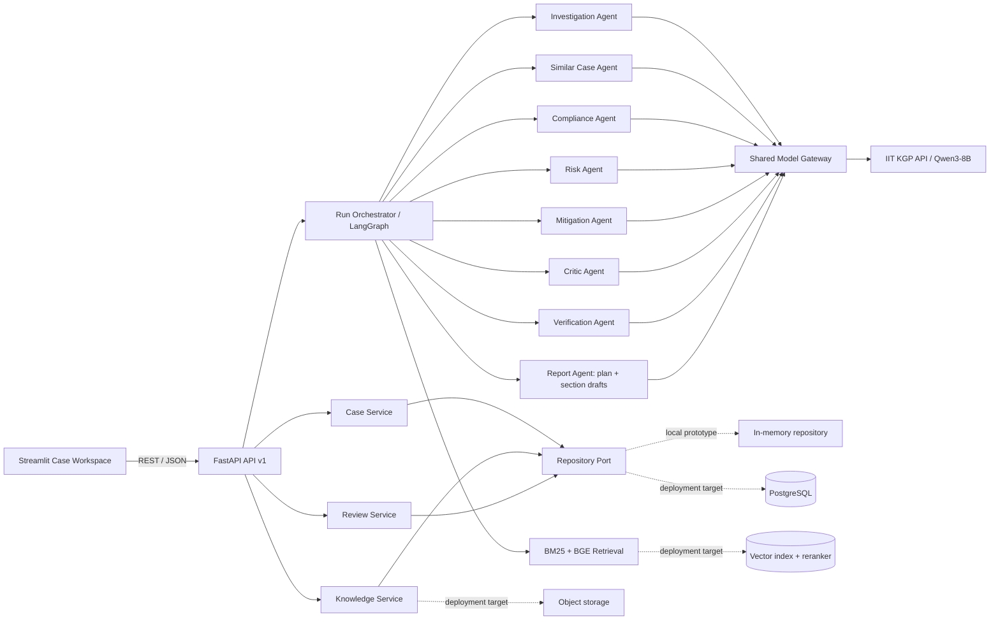

# BlackWing AI Application Architecture

The current local implementation is documented in [Local agentic delivery](local-agentic-delivery.md), including the Planner/Executor/Critic graph, audited executable tools, durable SQLite history, interrupted-run recovery and test artifacts. That document supersedes the original Draft 1 design below where behavior differs: the current bounded workflow has one targeted correction, a ten-step cap, deterministic report assembly and provisional reference-matrix risk classifications. The following Draft 1 material is retained as architectural history.

## Draft 1 scope

The first vertical slice supports runway-incursion cases only. It creates a case, stores source metadata and text, retrieves chunked candidate passages, runs eight role-specific agents (including a task-decomposed Report Agent), exposes the report and trace, and records a human review. The agents are workflow roles, not separate model deployments.

## Component architecture

## Runtime flow

1. The UI creates a case through `POST /api/v1/cases` and may attach evidence in the same request or through `/evidence`.
2. The API validates the runway-incursion category, metadata and narrative, then returns a `case_id`.
3. The versioned RAG index is built from the approved `01_RAG_KNOWLEDGE_BASE` manifest. Knowledge documents uploaded at runtime remain in memory and can be added to the index for that process. The app does not seed final reports. Gold evaluation files and unseen case prompts are not indexed.
4. `POST /api/v1/cases/{case_id}/runs` starts a run and returns `202 Accepted` with a `run_id`. The API retrieves up to five passages with BM25, hosted IIT BGE dense embeddings, reciprocal-rank fusion, and a small operational-term rerank. If the hosted embedding service is unavailable, the search reports and uses BM25 fallback.
5. LangGraph passes the narrative and supplied/retrieved evidence through Investigation, Similar Case Analysis, Compliance, Risk, Mitigation, Critic, Verification and Report nodes in order. Similar Case Analysis is deterministic and deduplicates by source; other applicable roles call the selected model provider. Compliance returns `not_assessed` when no authoritative rule source is present. Historical probable causes may inform questions to check but never become current-case findings.
6. Report Agent receives agent outputs as upstream context. It plans four fixed sections and drafts each with a separate prompt and schema-sized model call; a deterministic section summary is used if a section response cannot be validated. It assembles the structured report without removing the source agent outputs.
7. The API records run progress, agent results and report-task trace events. The Streamlit UI polls `GET /api/v1/runs/{run_id}` and displays the report as its primary view, with source JSON and trace in separate tabs.
8. `GET /api/v1/cases/{case_id}/report` returns the latest completed output, marked preliminary. A reviewer records a decision through `/reviews` with rationale and any finding overrides.

## Service boundaries and ownership

| Component | Responsibility | Draft 1 implementation |
| --- | --- | --- |
| API layer | Versioned request/response validation, resource links, HTTP statuses | FastAPI `/api/v1` |
| Case service | Narrative, category, date, location and evidence metadata | API handlers |
| Knowledge service | Document metadata/content, date and jurisdiction filters, chunked candidate excerpts | In-memory store; BM25 + BGE dense + reciprocal-rank fusion + operational-term rerank |
| Workflow service | Agent ordering, shared case context, run state and trace | LangGraph, sequential nodes |
| Model gateway | Hosted inference transport and schema validation | IIT KGP OpenAI-compatible `/chat/completions`; assigned URL, model, key and CA certificate path resolved from environment-backed properties; TLS verification stays enabled |
| Deterministic safety services | Citation checks, schema checks, provisional 5×5 severity × likelihood scoring | 1–25 product; highest per-hazard score and provisional bands, human review required |
| Review service | Reviewer decision, rationale and override history | Review endpoint; in-memory record |
| Repository port | Persistence boundary | In-memory adapter for local single-process prototype |

### Agent package ownership

Every agent lives in its own package at `blackwing/agents/<agent_id>/`. Each package owns its prompt file (`prompt.md`), structured output schema (`schema.py`), and agent registration (`agent.py`). The coordinator imports registered `AgentSpec` objects from `agents/registry.py`; shared request construction, safety instructions, model transport and schema validation live in `agents/runtime.py`. Upstream context is declared on each agent spec so edits to one role remain localized and reviewable.

Prompting strategy follows agent responsibility. The Investigation Agent uses few-shot examples in its prompt to demonstrate how to classify documented facts, reported observations, and unknowns; examples are illustrative only and must never be copied as case evidence. Other model-backed analysis agents use zero-shot instructions in their package prompt files. Similar Case Analysis is deterministic and does not call the model. The Report Agent uses task breakdown prompting: it follows a fixed four-section plan and drafts each section in a separate focused call with task-relevant upstream outputs.

## Data model

- **Case:** `case_id`, category, narrative, incident date, jurisdiction, location, status, evidence references, timestamps.
- **Evidence:** `evidence_id`, title, document type, source ID/URL, jurisdiction, document/effective dates, excerpt.
- **Knowledge document:** `document_id`, title, type, source identifiers, jurisdiction, dates, text content and timestamp.
- **Analysis run:** `run_id`, `case_id`, workflow, status, model, progress, result, error summary and timestamps.
- **Trace event:** ordered step, agent, model, status, timestamp and safe detail.
- **Review:** `review_id`, reviewer identifier, decision, rationale, overrides and timestamp.

## Status lifecycles

- Case: `draft` → `analysis_running` → `analysis_complete` → `reviewed`; a failed run sets `analysis_failed`.
- Run: `queued` → `running` → `completed` or `failed`.
- Review decision: `approve`, `reject`, or `request_changes`. Approval records a human decision; it does not establish legal or regulatory authority.

## Deployment target and prototype limits

The supplied diagrams describe independently deployable services, JWT/OIDC and RBAC, PostgreSQL, MinIO, Qdrant and Redis. The current local implementation keeps API, orchestration and agents in one process, uses one configured chat model, and stores user data in memory. The BGE model is local through FastEmbed; the first search downloads its ONNX weights. Restarting the API loses cases, ingested sources and the in-memory embedding cache, and multiple API workers would not share state. Production deployment must replace the in-memory repository with PostgreSQL/object storage, add identity and case-level authorization, persist a vector index, configure deterministic risk scoring, migrations and durable background jobs.

The LLM outputs remain untrusted proposals. The system does not establish source truth, regulatory applicability, legal liability or operational instructions. A qualified reviewer must check material claims and make the review decision.

### Dataset split policy

The dataset builder permits source paths only under `01_RAG_KNOWLEDGE_BASE` and honors both `approved` and `trial_index_eligible` manifest flags. It excludes paths under `02_GOLD_EVALUATION_PROTECTED` and `03_UNSEEN_INCIDENT_TEST_CASES`. The unseen set is used as retrieval-only validation input. The golden sample prompt is sanitized to omit evaluator notes and answer files and is available as a Streamlit demo prefill; its matching preliminary report is excluded from the index and must be uploaded as current-case evidence. The UI extracts PDF/TXT text into the case evidence field, not the shared corpus. Final report answer keys remain held out.
