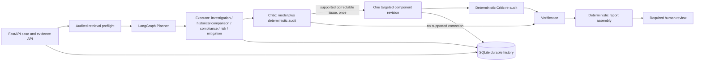

# BLACKWING AI local agentic delivery — 21 November 2026

Completed locally on `feature/arun-rag-risk-compliance` in `BlackWingAI-Arun-Git`. No commit or push was made. Existing user edits were retained. The separate `BLACKWING_LOCAL_DELIVERY` copy, protected datasets, saved chunks and vectors were not edited.

## Validation and readiness

The original baseline passed **83 tests**. The final complete suite passed **110 tests, zero failures, zero skips**, with two dependency deprecation warnings, in **5.63 seconds**. The 27 added test cases exercise actual Python tools and LangGraph execution with mocked model IO. Outbound socket connections are blocked during tests, except Windows asyncio's internal socketpair; the default retrieval fixture uses lexical retrieval without downloading or generating embeddings.

| Requirement | Result and evidence |
| --- | --- |
| Genuine tools | All three executed in API/graph tests and against the real saved local corpus; see `validation/agentic-local/actual_local_tool_executions.json` |
| Tool failure recovery | Both initial and agent-packet retrieval failure are traced; workflow continues with available uploads or empty evidence, without invented sources |
| Planner routing | Authoritative-rule availability selects model comparison or deterministic unassessed compliance; the executor consumes planner modes |
| Successful targeted correction | Mitigation alone reruns; deterministic Critic re-audit confirms the fix; 10 execution steps and one attempt |
| Impossible correction | Missing evidence remains unresolved for human review; no retry; nine execution steps |
| Failed correction | One failed target retains prior valid outputs; terminates at 10 steps with unresolved findings |
| Execution limit | Executor refuses another agent when the configured hard step limit is reached |
| Restart persistence | Completed results, metadata, reviews, reports and traces survive a new repository instance; a separate Python process also verifies saved state and interrupted-run recovery |
| Risk and mitigation | Supported synthetic C2 hazard receives high provisional reference risk and H1-linked mitigation; missing inputs produce null scores |
| API compatibility | Creation, evidence, polling, seven agent outputs, risk, mitigation, Critic, review, report and JSON/Markdown export pass API tests |
| Incident independence | JFK, Austin, Goa, Delhi and synthetic narratives use the same bounded mocked workflow; this is structural testing, not real-case answer-quality evaluation |

Raw test results: [regression.xml](validation/agentic-local/regression.xml). Captured planning/correction outcomes: [planner_executor_critic.json](validation/agentic-local/planner_executor_critic.json).

The backend is ready for local single-worker integration and controlled live provider testing. Hosted connectivity, model answer quality and the actual frontend integration remain unverified.

## Architecture



The deterministic Planner selects role modes and records source availability, required tools, correction policy and execution budget. Existing response contracts require all role keys, so an unavailable analysis returns an explicit unassessed result. Optional evidence retrieval remains controlled by `include_retrieval`; agent-specific packets remain enabled by `BLACKWING_AGENT_RAG=1`.

The Executor reuses existing agent functions, grounding guards, historical comparator and deterministic risk matrix. The complete standard graph has nine counted steps: one Planner plus eight role executions. One targeted correction brings the maximum to ten. Tool calls are synchronous functions inside those tasks, not additional recursive graph tasks. Each existing model invocation retains its bounded two-attempt schema repair; hosted transport retries remain separately bounded to three attempts. There is no full-workflow retry or graph loop.

The report role assembles the existing four typed sections from grounded agent outputs without additional model calls. This keeps the investigation within the step budget. The standalone `create_report` API retains its existing model-drafting default; the bounded investigation explicitly selects deterministic assembly.

Only existing evidence can support a correction. Mitigation correction requires an evidenced hazard; Investigation/Risk correction requires usable incident evidence. Unsupported or non-correctable issues remain for a human. The deterministic Critic predicates are re-evaluated after correction; other model concerns and missing analyses remain visible. Re-grounding mitigation links is deterministic and does not launch another investigation.

## Executable tools and actual results

`blackwing/tools.py` wraps the callable itself, measures duration around execution, and records success only after it returns. Every workflow invocation has an ID, case ID, input identifiers, status, result summary, duration, timestamp and sanitized error type. Error messages/provider bodies are excluded from tool audit records. A successful call can correctly return an unassessed/no-match result; that is distinct from a failed execution.

| Tool | Existing implementation reused | Real local smoke result |
| --- | --- | --- |
| `retrieve_evidence` | Existing retriever/agent packet builder; smoke uses saved `HybridIndex.search` | Three incident-specific passages, BM25 over existing chunks |
| `find_similar_incidents` | Deterministic historical source comparator | Three historical ASRS analogies, clearly labeled voluntary self-reports |
| `assess_reference_risk` | Existing severity–likelihood matrix, invoked after citation validation for each hazard | Calculator executed and returned `unassessed_insufficient_inputs`; the smoke supplies no inferred severity/likelihood |

The actual corpus smoke uses a dynamically selected incident identifier, not an airport-specific branch. Automated synthetic tests separately prove valid risk classifications, including C2/high, A1/high, E1/special review and E5/low. ASRS voluntary records are accepted by the comparator only when explicitly routed as historical analogies; they never establish current-event causes.

Tool and state events are durable immediately. Completed structured traces are available through the existing `/trace` endpoint and report. While a run is active or failed, `/trace` exposes already-executed tool events. The additive `/api/v1/runs/{run_id}/audit` endpoint also exposes planning, partial outputs, step count and recovery semantics.

## Persistent state and recovery

`SQLiteRepository` preserves `MemoryRepository` methods. MemoryRepository remains available for isolated tests. The application lazily opens SQLite on first repository use. Set `BLACKWING_DATABASE_PATH` to choose the file; the default is `<repository>/work/blackwing.sqlite3`, independent of launch directory. SQLite uses WAL, full synchronous writes and atomic write-through mutations.

The records store persists cases, uploaded evidence metadata/text, knowledge sources, runs, partial/final agent outputs, Critic results, reviews, final report payloads and report references. A separate audit table records events; full run records also retain them. A report reference includes its run ID; the existing case-report URL continues to resolve the latest completed run, and the earlier payload remains in durable run history.

This is durable run history, **not checkpoint resumption**. Reopening the application marks queued/running runs `failed` with `error_code=interrupted`, preserves their partial outputs and audits, and releases the case for a new controlled run. Existing status enum values remain compatible. Recovery is `POST /api/v1/cases/{case_id}/runs`; it creates a new run ID and retains the interrupted run.

Use **one API process/worker per database and hosted API key**. SQLite's in-process repository cache and the hosted limiter are deliberately local. Multi-worker coordination is not implemented. Existing in-memory data from a previously stopped process cannot be recovered retrospectively.

## Corpus preservation

Both `expanded_bge_asrs_20261121` and `expanded_bge_asrs_metadata_v2` were opened read-only. Their manifest/chunk signatures and raw vector hashes verified successfully; each contains **777 documents and 27,255 chunks**. The verified raw vector hash is `900b2aa7be2bfec88305f1e5f9f9477d917cd7e26006cf83c07ffa370fdf5f9f`.

No index save/build or embedding generation was run against these corpora. Existing historical/date/jurisdiction routing and protected-gold exclusion remain in place. [corpus_integrity.json](validation/agentic-local/corpus_integrity.json) records the checks. The manifests still mark institute document eligibility, independent answer quality and true Recall@k as pending/unverified; this implementation does not change those assessments.

## IIT-hosted test instructions

No IIT request was made. Existing local Ollama configuration remains supported. For a later authorized hosted smoke, start from the repository root and configure one API worker:

```powershell
$env:BLACKWING_CONFIG = "$PWD\config\blackwing.properties"
$env:BLACKWING_API_HOST = "127.0.0.1"
$env:BLACKWING_API_PORT = "8000"
$env:BLACKWING_LLM_PROVIDER = "openai_compatible"
$env:BLACKWING_LLM_API_BASE_URL = "<IIT OpenAI-compatible base URL>"
$env:BLACKWING_LLM_API_MODEL = "<IIT Qwen3-8B model identifier>"
# Supply BLACKWING_LLM_API_KEY from your environment/secret manager.
# Do not paste it into source, reports, commands stored in Git, or logs.
$env:BLACKWING_LLM_API_TIMEOUT_SECONDS = "120"
$env:BLACKWING_LLM_API_TEMPERATURE = "0.1"
$env:BLACKWING_LLM_API_MAX_OUTPUT_TOKENS = "512"
$env:BLACKWING_MODEL_RESPONSE_LOG_LIMIT = "0"
$env:BLACKWING_UI_API_URL = "http://127.0.0.1:8000"
$env:BLACKWING_UI_TIMEOUT_SECONDS = "1800"
$env:BLACKWING_DATABASE_PATH = "$PWD\work\blackwing.sqlite3"
$env:BLACKWING_AGENT_RAG = "1"
$env:BLACKWING_AGENT_RAG_METHOD = "hybrid"
$env:BLACKWING_RAG_BACKEND = "local"
$env:BLACKWING_RAG_EMBEDDING_MODEL = "BAAI/bge-small-en-v1.5"
$env:BLACKWING_RAG_INDEX_DIR = "$PWD\rag_indexes\expanded_bge_asrs_metadata_v2"
$env:BLACKWING_QWEN_TOKENIZER = "<locally cached matching Qwen3-8B tokenizer directory>"
# If IIT requires a private CA: set BLACKWING_LLM_CA_CERT to its trusted bundle.
.\.venv\Scripts\python.exe -m uvicorn blackwing.api:app --host 127.0.0.1 --port 8000 --workers 1
```

Cache the exact tokenizer and matching local BGE query-embedding weights before live testing. The existing vectors are reused; no index build is needed. Hosted inference fails before requests if exact local token preflight is unavailable or too large. The working input budget is 2,600 tokens, plus a 256-token margin, below the hard combined 8,192 ceiling. Output is capped at 1,024. A shared process lock permits one outstanding hosted request, paced at least 1.05 seconds apart (default 1.1), below 60/minute. Each transient HTTP 429/500/502/503/504 or connection/timeout failure gets at most three total attempts with pacing/backoff. Non-transient HTTP errors are not retried. Do not share the same key with another independent process during testing.

Check `/health` and OpenAPI first, then create one synthetic case, attach available factual evidence, request one run, poll it, inspect `/trace` and `/audit`, and inspect the preliminary report. Restart the API after completion and confirm the same run/report/review remains. Only then progress to the five incident scenarios. Verify actual provider token usage and model ID against IIT's supplied configuration. Hosted raw responses are not logged; Settings repr omits the key and diagnostics redact it.

## Sunayana UI integration requirements

The repository's `blackwing/ui.py` was inspected for create/run/poll/report/trace calls. Its code was not changed or exercised as a real frontend. No claim of frontend integration success is made.

| UI action | Existing backend contract |
| --- | --- |
| Create incident | `POST /api/v1/cases`; use `source_incident_id` for the external source identity |
| Upload evidence | `POST /api/v1/cases/{id}/evidence` while draft; current contract accepts text/metadata, not multipart files |
| Execute and poll | `POST /api/v1/cases/{id}/runs`, then `GET /api/v1/runs/{run_id}` |
| Results/risk/mitigation/Critic | `GET /api/v1/cases/{id}/report`, under `report.agent_outputs` |
| Execution details | Existing `/runs/{id}/trace`; additive `/runs/{id}/audit` for plan, partial state and recovery |
| Human review | `POST`/`GET /api/v1/cases/{id}/reviews` with rationale and optional overrides |
| Export | `GET /api/v1/cases/{id}/report/export?format=json` or `format=md` |

The frontend should tolerate additive optional trace fields, show null/unassessed risk rather than zero, keep ASRS analogies separate, display unresolved Critic issues and required human review, and handle `failed/error_code=interrupted` by offering a new run. Approval remains a recorded human decision; `is_final` stays false. Browser clients on another origin need deployment-specific CORS/proxy configuration. Authenticate reviewers before any nonlocal deployment; authentication remains outside this requested local scope.

## Files changed in this delivery

Existing files edited:

- `blackwing/agents/report/workflow.py` — deterministic bounded report assembly option.
- `blackwing/agents/risk/evidence.py` — route actual calculator calls through auditing; existing user risk changes retained.
- `blackwing/agents/similar_case/agent.py` — explicitly historical voluntary ASRS comparison and caution.
- `blackwing/agents/runtime.py` — transient transport retries, output guard, correction prompt, secret-safe diagnostics.
- `blackwing/api.py` — audited retrieval/recovery, durable updates, compatible traces, additive audit endpoint.
- `blackwing/config.py` — exclude API credential from Settings repr.
- `blackwing/repository.py` — compatible SQLite implementation and interrupted-run recovery.
- `blackwing/schemas.py` — additive optional trace audit fields.
- `blackwing/service.py` — Planner/Executor/Critic conditional correction and hard step cap; existing user edits retained.
- `tests/test_runway_incursion_contract.py` — preserve seven-agent assertion while accepting real tool events; existing user edits retained.
- `README.md`, `docs/architecture.md`, `docs/api-contract.md` — current behavior and delivery links.

New files:

- `blackwing/tools.py`, `blackwing/planning.py`.
- `tests/conftest.py`, `tests/test_agentic_local.py`.
- `scripts/validate_local_tools.py` — reproducible read-only saved-corpus smoke.
- This document and five files in `docs/validation/agentic-local/`: actual tool traces, corpus integrity, correction outcomes, JUnit XML and regression summary.

Pre-existing edits to risk prompt/schema, RAG engine/context, risk tests, the matrix module, diagnostic files, ASRS data and gold-date utility were not independently authored by this delivery. They remain uncommitted as found.

## Reproduce local verification

```powershell
.\.venv\Scripts\python.exe -m pytest -q
.\.venv\Scripts\python.exe scripts\validate_local_tools.py work\agentic-readonly-validation
```

Remaining limits: one local worker; no resumable graph checkpoints; conservative deterministic correction predicates rather than open-ended replanning; deterministic report prose in the bounded workflow; no live provider/independent answer-quality evaluation; no actual frontend test; evidence uploads retain the existing text-only contract. All results continue to require qualified human review.
